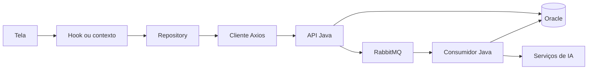

# Lares

**Seu bairro, cuidado por todos.** Aplicativo Android de zeladoria colaborativa da Driven Soft para a Global Solution CitizenTech da FIAP.

## Links da entrega

| Recurso | Acesso |
| --- | --- |
| Código-fonte | [Driven-Soft/Lares-Mobile](https://github.com/Driven-Soft/Lares-Mobile) |
| Vídeo no YouTube | `A_PREENCHER_PELO_LUCAS` |
| API Java no Render | [Estado do serviço](https://laresapi-java.onrender.com/actuator/health) · [Repositório da API](https://github.com/Driven-Soft/LaresApi-Java) |
| Firebase App Distribution | [Portal de testers](https://appdistribution.firebase.dev/). O acesso ao APK será liberado por convite após a publicação. |

## Problema e solução

Quem encontra uma calçada danificada precisa saber onde registrar o problema e como acompanhar a resposta. A prefeitura precisa organizar esses relatos por bairro e prioridade. No Lares, o cidadão descreve a ocorrência, a API coordena a triagem e o gestor registra o andamento. O morador acompanha cada mudança na linha do tempo. O projeto contribui para o ODS 11 ao apoiar a manutenção dos espaços urbanos e para o ODS 10 ao tornar o acompanhamento do atendimento acessível a moradores de diferentes bairros.

## Telas e permissões

| Tela | Quem usa | O que permite fazer |
| --- | --- | --- |
| 1. Login | Ambos | Entrar com e-mail e senha e abrir as abas do seu papel. |
| 2. Criar conta | Cidadão | Cadastrar-se. A prefeitura fornece as contas de gestor. |
| 3. Minhas ocorrências | Cidadão | Consultar seus relatos e iniciar um registro. |
| 4. Nova / Editar ocorrência | Cidadão | Informar descrição e bairro. A localização pode preencher o bairro. |
| 5. Detalhe da ocorrência | Ambos | Ver status, análise e histórico. O autor pode editar ou excluir enquanto estiver em Recebida ou Triada. |
| 6. Bairro | Cidadão | Buscar por bairro e status. Relatos de outros moradores abrem em modo de leitura. |
| 7. Fila | Gestor | Atender por prioridade e filtrar por status e bairro. |
| 8. Atualizar status | Gestor | Iniciar ou concluir o atendimento, escolher ou corrigir a categoria e comentar para o morador. |
| 9. Perfil | Ambos | Consultar identificação, papel e sair da conta. |
| 10. Sobre o app | Ambos | Conferir versão, equipe e commit da instalação. |

## Arquitetura



A API grava o relato como **Recebida** antes de iniciar a triagem. O consumidor obtém a classificação e atualiza o registro. O detalhe consulta a API para exibir o resultado. Com a sessão autenticada, o cliente HTTP envia o token nas chamadas protegidas. [Guia de apresentação e fluxos do toque ao banco](docs/GUIA_DE_APRESENTACAO.md)

### Bibliotecas e ferramentas

| Pacotes | Uso no projeto |
| --- | --- |
| `react`, `react-native`, `expo` | Componentes e estado das telas, controles nativos e execução do projeto no Android. |
| `@react-navigation/native`, `@react-navigation/native-stack`, `@react-navigation/bottom-tabs` | Contêiner de navegação, pilha para detalhes/formulários e abas específicas de cidadão e gestor. |
| `react-native-screens`, `react-native-safe-area-context` | Telas nativas da pilha e espaçamento para barras do sistema. |
| `axios`, `@tanstack/react-query` | Axios centraliza URL, timeouts e interceptores. React Query coordena cache por usuário, paginação, polling e atualização após gravações. |
| `expo-secure-store`, `expo-location` | Armazenamento protegido da sessão e localização opcional com consulta do bairro por coordenadas. |
| `nativewind`, `tailwindcss` | Aplicação das classes nas telas e definição dos tokens de cor, tipografia e dimensões. |
| `react-native-reanimated`, `react-native-worklets` | Suporte nativo de animações usado pela integração de estilos do NativeWind e execução de worklets do Reanimated. |
| `@expo-google-fonts/inter`, `expo-font`, `@expo/vector-icons` | Arquivos da fonte Inter, carregamento dos pesos e ícones de navegação e ações. |
| `expo-splash-screen`, `expo-status-bar`, `expo-constants` | Abertura com a marca até o carregamento das fontes, aparência da barra de status e leitura da versão e do hash em Sobre. |
| `babel-preset-expo`, `typescript`, `@types/react` | Transformação do código para o Expo e checagem estática dos componentes e contratos HTTP. |
| `eslint`, `eslint-config-expo`, `prettier`, `prettier-plugin-tailwindcss` | Análise do código com as regras do Expo, formatação e ordenação das classes. |

### Estrutura do repositório

| Caminho | Responsabilidade |
| --- | --- |
| `App.tsx`, `src/routes/` | Providers globais, fontes, pilha e abas protegidas. |
| `src/screens/`, `src/components/`, `src/theme/` | Telas, componentes compartilhados e identidade visual. |
| `src/context/`, `src/hooks/` | Sessão, avisos, consultas, mutações, localização e ciclo da triagem. |
| `src/repositories/`, `src/services/` | Operações por recurso, cliente HTTP, erros e persistência da sessão. |
| `src/repositories/mock/` | Implementações locais e fixture dos cenários de teste. |
| `src/models/`, `src/utils/`, `src/config/` | Tipos do contrato, regras de status, datas, validações e configuração do cache e do mock. |
| `assets/images/`, `docs/` | Ícones e splash do Lares, guia de apresentação e checklist da entrega. |

## Como executar

Use Node.js 22.13 ou posterior da série 22, npm e um aparelho ou emulador Android com Expo Go compatível com o SDK 58. Na raiz do projeto, execute:

```powershell
npm install
Copy-Item .env.example .env.local
npx expo start
```

No aparelho, leia o QR code do Expo. Para abrir no emulador em execução, pressione **a** no terminal. No macOS ou Linux, use `cp .env.example .env.local` para copiar o arquivo.

| Variável | Valor e finalidade |
| --- | --- |
| `EXPO_PUBLIC_API_URL` | O exemplo aponta para `https://laresapi-java.onrender.com`. Para a API local, use `http://10.0.2.2:8080` no emulador Android padrão ou `http://<IP-da-máquina>:8080` no aparelho, com ambos na mesma rede e a porta acessível. |
| `EXPO_PUBLIC_USE_MOCK` | Ausente por padrão. O valor literal `true` ativa os dados simulados em desenvolvimento. Reinicie o Expo e recarregue o aplicativo após alterar o ambiente. |

O app chama `GET /actuator/health` ao abrir Login ou Cadastro para **acordar a API no Render**. O servidor pode dormir por inatividade no plano gratuito. A chamada roda enquanto a pessoa preenche o formulário. Se o primeiro acesso demorar, o app exibe **Acordando o servidor…** durante o envio.

### Contas públicas de demonstração da API

| Papel | E-mail | Senha de teste |
| --- | --- | --- |
| Cidadão | `cidadao.teste@example.com` | `CidadaoDemo2026!` |
| Gestor | `gestor.teste@example.com` | `GestorDemo2026!` |

### Mock de desenvolvimento

Em `.env.local`, defina `EXPO_PUBLIC_USE_MOCK=true`. Entre como `cidadao@lares.test` ou `gestor@lares.test`, ambos com a senha fictícia `LaresTeste7`. As contas, a sessão e as alterações ficam em memória até o app ser recarregado. O perfil EAS usa a API real e o bundle de produção desativa o mock.

Crie um relato para acompanhar **Recebida → Triada** após cerca de cinco segundos. No bairro **Centro**, a conta local do cidadão tem quatro casos identificados pela descrição: recebida permanente, triada sem textos, prazo ausente e falha na primeira abertura do detalhe. Neste último, toque em **Tentar novamente**. Para voltar à API, remova a variável e reinicie o Expo.

## Verificação e limites conhecidos

Execute `npm run format`, `npm run typecheck` e `npm run lint`. O envio e a consulta de dados reais dependem da conexão. Se a IA estiver indisponível, a ocorrência pode permanecer em Recebida. O detalhe consulta a cada três segundos enquanto está ativo e interrompe a espera automática após três minutos. O morador pode puxar para atualizar, e o gestor pode iniciar o atendimento escolhendo a categoria. Textos e prazos podem vir vazios. Se o GPS ou a consulta de endereço falhar, o bairro continua editável.

As listas preservam a ordem da API entre páginas. Nos testes, Minhas ocorrências veio da mais antiga para a mais recente e a busca sem `sort` veio da mais recente para a mais antiga. A Fila solicita `sort=prioridade`.

## Hash do commit e distribuição Android

`app.config.js` grava em `extra.commitHash` os sete primeiros caracteres de `EAS_BUILD_GIT_COMMIT_HASH`. Em execução local, usa `git rev-parse --short HEAD`. A tela **Perfil → Sobre o app** lê esse valor pelo Expo Constants.

1. Finalize o vídeo e registre o link no README. Publique o commit de entrega e anote seu hash.
2. Com a conta Expo da equipe e o projeto EAS configurado, execute `npx eas-cli build -p android --profile apk` a partir desse commit. O perfil `apk` em `eas.json` aponta para o Render.
3. No Firebase App Distribution, envie o APK para o app Android `br.com.fiap.drivensoft.lares` e convide o professor como tester.
4. Instale pelo convite, confira o hash em **Sobre o app** e teste o ciclo cidadão–gestor em dados móveis. [Checklist de entrega](docs/CHECKLIST_ENTREGA.md)

## Equipe Driven Soft

| Integrante | RM |
| --- | --- |
| Felipe Bezerra Beatrici | 564723 |
| Henrique Cunha Torres | 565119 |
| Lucas da Silva Lima | 562118 |
| Max Hayashi Batista | 563717 |
| Yasmin Nathalin Miranda dos Santos | 561365 |
