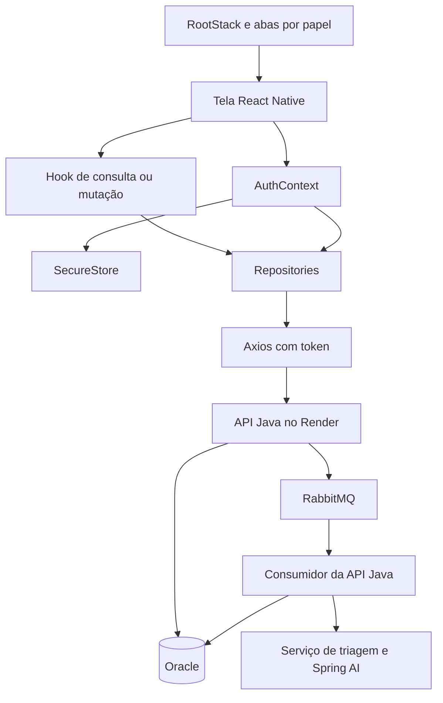

# Guia de apresentação do Lares

Comece com um relato concreto. Uma moradora encontra um poste apagado, registra a rua e o bairro e consegue acompanhar a resposta da prefeitura pelo celular. Mostre a mesma ocorrência nas contas de cidadão e gestor. O número, a descrição e o comentário ajudam a plateia a reconhecer o registro.

## Como o toque chega ao banco

### Login e restauração da sessão

1. Ao abrir Login, o app chama `GET /actuator/health` em segundo plano. Isso antecipa o despertar do serviço gratuito do Render enquanto o usuário digita.
2. **Entrar** valida os campos e chama `AuthContext.entrar`. O repository envia e-mail e senha a `POST /auth/login`. A API confere o usuário e a senha contra o hash armazenado em `LARES_USUARIO` e devolve token, identificador, nome e papel.
3. O contexto salva a sessão em SecureStore. O `RootStack` escolhe as abas do cidadão ou do gestor. O cliente Axios acrescenta o token Bearer às consultas protegidas.
4. Ao reabrir o app, a sessão é restaurada. Em **Sair**, sessão e cache são limpos. Uma resposta 401 em uma chamada protegida também expira a sessão correspondente.

### Registro de ocorrência e triagem

1. Em **Nova ocorrência**, o cidadão descreve o problema e indica o bairro. A localização é opcional. Ao tocar em **Enviar**, o formulário valida os dados e a mutação chama `POST /ocorrencias`.
2. A API registra a autoria e o estado `RECEBIDA` em `LARES_OCORRENCIA`, grava a abertura em `LARES_HISTORICO_STATUS` e devolve o ID. O app abre o detalhe desse ID.
3. A API publica o evento em RabbitMQ. O consumidor Java pede categoria, prioridade e prazo ao serviço de triagem. Os textos para o morador e a gestão vêm do Spring AI. A atualização da ocorrência e o novo evento da linha do tempo ficam no Oracle.
4. Enquanto o cidadão acompanha **Recebida**, o detalhe consulta `GET /ocorrencias/{id}` a cada três segundos. Ao receber **Triada**, ele exibe o resultado e atualiza as listas. O polling pausa ao sair da tela ou do app e encerra a espera automática após o limite de três minutos. Ainda é possível puxar para atualizar.
5. Se a IA estiver indisponível, demonstre o atendimento manual de uma recebida. Se apenas os textos faltarem, mostre a classificação. Se o prazo estiver ausente, a tela exibe **—**.

### Atendimento do gestor e retorno ao cidadão

1. **Fila** busca `GET /ocorrencias?status=TRIADA&sort=prioridade`. O gestor abre o detalhe e toca em **Atualizar status**. O seletor carrega `GET /categorias`.
2. A tela oferece um próximo passo: **Recebida** ou **Triada** pode ir para **Em andamento**, e **Em andamento** pode ir para **Resolvida**. A categoria é obrigatória para iniciar um atendimento sem triagem.
3. **Confirmar** envia `PATCH /ocorrencias/{id}/status` com o novo status, o comentário opcional e `categoriaId` quando o gestor escolheu ou trocou a categoria. A API valida o papel e a transição, atualiza a ocorrência e grava o evento e seu autor no histórico.
4. O app invalida as consultas, volta ao detalhe e informa o resultado. Um conflito 409 provoca recarga para mostrar o estado atual. Volte à conta da moradora e abra a mesma ocorrência para mostrar o comentário na linha do tempo.

## Onde fica cada coisa

| Pergunta da banca | Onde mostrar | O que explicar |
| --- | --- | --- |
| Quem decide quais telas posso abrir? | [RootStack](../src/routes/RootStack.tsx) e [rotas tipadas](../src/routes/types.ts) | A sessão define as abas e os formulários disponíveis. A API verifica a permissão novamente em cada operação. |
| Quem guarda o login? | [Contexto de autenticação](../src/context/AuthContext.tsx) e [armazenamento](../src/services/sessaoStorage.ts) | O contexto coordena entrar, restaurar e sair. SecureStore mantém a sessão protegida no aparelho. |
| Quem conversa com a API? | [Cliente Axios](../src/services/api.ts) e [repository de ocorrências](../src/repositories/ocorrenciaRepository.ts) | O cliente centraliza token, timeout e expiração. O repository traduz uma operação do app em rota HTTP e resposta tipada. |
| Como uma alteração chega às listas? | [Hooks de ocorrências](../src/hooks/useOcorrencias.ts) | React Query pagina, compartilha resultados por usuário e filtros e invalida consultas após as mutações. |
| Por que consultar de três em três segundos? | [Hook do detalhe](../src/hooks/useDetalheOcorrencia.ts) | A API confirma o registro antes de terminar a classificação. O polling acompanha essa janela e tem limite de tempo e de foco. |
| De onde vêm cores, tipos e medidas? | [Tema](../src/theme/cores.ts), [Tailwind](../tailwind.config.js) e [componentes](../src/components) | NativeWind compartilha estilos de campos, botões e cartões. Etiquetas usam rótulo além da cor. |
| Como repetir uma falha da IA? | [Seleção dos repositories](../src/repositories/index.ts) e [cenários locais](../src/repositories/mock) | O mock implementa o mesmo contrato em memória e exige a flag de desenvolvimento. Permite repetir atrasos, dados ausentes e falha de rede. |

A divisão por responsabilidade permite mudar o formato HTTP no repository, regras comuns em `utils/` e apresentação em `screens/` ou `components/`. Tipos compartilhados em `models/` revelam quais consumidores precisam acompanhar uma mudança.

## Onde mexer se o requisito mudar

| Mudança | Caminho de implementação e conferência |
| --- | --- |
| Novo status | Alinhar o contrato da API. Atualizar `StatusOcorrencia` em `models/ocorrencia.ts`, transições em `utils/ocorrencia.ts`, rótulos em `theme/cores.ts`, progresso, filtros e rodapés. Testar os dois papéis e o fluxo de status no mock. |
| Novo campo no relato | Definir tipo e nulabilidade no contrato, ajustar formulário, validação, payload e detalhe. Atualizar fixtures e verificar a leitura de ocorrências anteriores. |
| Nova aba | Registrar o nome em `routes/types.ts`, a tela em `CidadaoTabs.tsx` ou `GestorTabs.tsx` e ícone e acessibilidade em `opcoesAbas.tsx`. Conferir o papel que pode abri-la. |
| Outra URL da API | Alterar `EXPO_PUBLIC_API_URL` no ambiente local e no perfil de distribuição de `eas.json`. Reiniciar o Expo em desenvolvimento e gerar a próxima versão para distribuir a mudança. |
| Novo filtro | Acrescentar o parâmetro ao contrato e a `FiltroBusca`. Ligá-lo à tela, à chave da consulta e ao repository real e mock. Conferir contagem, mudança de filtro e página seguinte. |
| Outro provedor de autenticação | Adaptar `authRepository`, `AuthContext`, armazenamento e interceptores ao novo contrato. Conferir login, restauração, expiração, logout e troca de papel sem reutilizar o cache da conta anterior. |

## Roteiro do vídeo de até cinco minutos

| Tempo | Demonstração |
| --- | --- |
| 0:00–0:25 | Apresente o problema, o tema CitizenTech e o bairro usado no exemplo. |
| 0:25–1:00 | Faça cadastro e login como cidadão. |
| 1:00–2:30 | Registre um problema, abra o detalhe, mostre a análise e a edição. Exclua um segundo relato de teste para preservar o primeiro para o gestor. |
| 2:30–3:05 | Filtre **Bairro**, abra uma ocorrência de outro morador em leitura e saia da conta. |
| 3:05–4:05 | Como gestor, abra a fila por prioridade e avance o atendimento com um comentário curto. |
| 4:05–5:00 | Mostre o comentário na conta do cidadão, abra **Sobre o app** para exibir o hash e encerre com o diagrama das camadas. |

Para a demonstração com API real, confira antecipadamente o servidor e separe uma ocorrência já triada. Assim, a equipe consegue explicar a classificação mesmo se o novo relato ainda estiver em processamento durante a gravação. [Preparação da entrega](CHECKLIST_ENTREGA.md)
